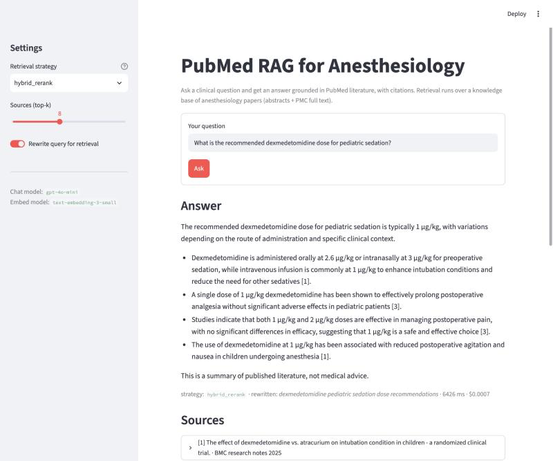
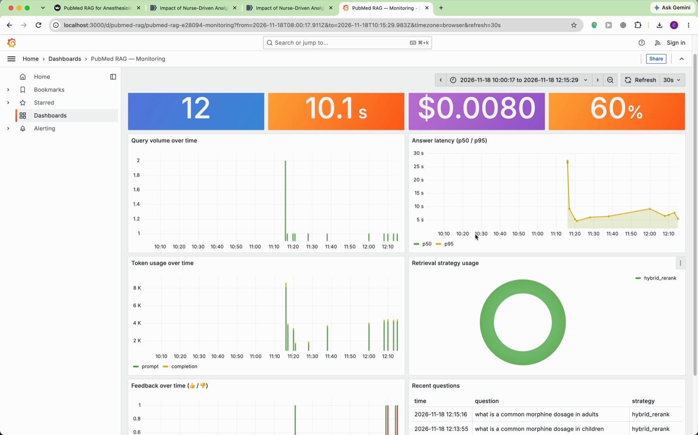

# PubMed RAG for Anesthesiology


[](https://github.com/staskut/pubmed-rag/actions/workflows/tests.yml)
[](LICENSE)


Evidence-grounded question answering over 5,000 PubMed papers.

The system retrieves and reranks relevant research, generates an answer only from
the retrieved evidence, and links every claim back to its source article.

**5,000 papers · 47,934 chunks · Hit Rate@10 0.94 · MRR@10 0.93**

> **This is a literature-retrieval assistant, not a medical decision tool.**
> Its answers summarize published research and are not medical advice.



*The Streamlit app: ask a clinical question, get a grounded answer with numbered citations,
retrieval strategy, latency, and cost. [Full-size image](docs/images/ui.png).*

## Highlights

- Answers include numbered citations linked back to PubMed.
- Hybrid retrieval combines keyword and vector search.
- A cross-encoder reranker improves the final document order.
- Evaluation compares four retrieval approaches and three answer prompts.
- User feedback, latency, token usage, and cost are monitored in Grafana.
- The complete system runs with Docker Compose.

An end-to-end RAG system covering ingestion, retrieval, generation, evaluation,
monitoring, and user feedback.

## The problem

Anesthesiologists and researchers answer specific questions ("What antiemetic is most
effective for high-risk PONV?", "Does sugammadex reduce residual neuromuscular blockade vs
neostigmine?") from the primary literature. Doing this by hand means searching PubMed and
skimming dozens of abstracts. This app does the retrieval and synthesis, and keeps the
clinician one click from the source paper — while refusing to answer when the evidence
isn't there, to limit hallucination.

## How it works

```
                     ┌──────────────────────────────────────────────┐
   PubMed (Entrez) ─▶│  dlt ingestion:  fetch → normalize → chunk    │
   PMC Open Access ─▶│  → embed (OpenAI)                             │
                     └───────────────────────┬──────────────────────┘
                                              ▼
                          ┌───────────────────────────────────┐
                          │ PostgreSQL + pgvector               │
                          │  articles · chunks(+embeddings,FTS) │
                          │  query_logs · feedback              │
                          └───────┬───────────────────┬─────────┘
        rewrite→retrieve→rerank→answer│               │ metrics
                                      ▼               ▼
   User ─▶ Streamlit UI ─▶ RAG (rag.py) ─▶ OpenAI      Grafana dashboard
              ▲   👍/👎 feedback     │                  (feedback + health)
              └─────────────────────┘
```

**Query flow** (`rag.py`): rewrite the question → **hybrid retrieval** (keyword + vector) →
**cross-encoder rerank** + dedupe → assemble a grounded prompt → LLM answer with `[n]`
citations → log the query, latency, tokens, and cost.

| Concern | Choice |
|---------|--------|
| LLM + embeddings | OpenAI `gpt-4o-mini` + `text-embedding-3-small` |
| Knowledge base | PostgreSQL + `pgvector` (vectors, keyword FTS, logs, feedback) |
| Ingestion | [dlt](https://dlthub.com/) (Entrez + PMC REST sources) |
| Retrieval | keyword (Postgres FTS) · vector (pgvector) · hybrid (RRF) · cross-encoder rerank ([fastembed](https://github.com/qdrant/fastembed), ONNX) |
| Interface | Streamlit |
| Monitoring | Grafana (auto-provisioned dashboard over Postgres) |
| Packaging | Docker Compose |

## Evaluation results

Both retrieval and answer quality are evaluated with multiple approaches; the winners are
what the app ships. Full method and results: **[docs/evaluation.md](docs/evaluation.md)**.

**Retrieval** (50 labeled question→PMID pairs, Hit Rate / MRR@10):

| Strategy | Hit Rate | MRR |
|----------|:--------:|:---:|
| keyword | 0.760 | 0.532 |
| vector | 0.920 | 0.867 |
| hybrid | 0.920 | 0.799 |
| **hybrid_rerank** | **0.940** | **0.882** |

With **query rewriting** (the production path), `hybrid_rerank` reaches **MRR 0.93** — the
best configuration, and the one the app ships.

**Answer quality** (LLM-as-a-judge, 1–5): the `structured` prompt won (**4.956** overall)
and is the production prompt. Reproduce both evaluations with `make eval`.

## Example answer

```
uv run python -m pubmed_rag.rag "Does sugammadex reduce residual neuromuscular blockade compared to neostigmine?"
```

```
Sugammadex significantly reduces residual neuromuscular blockade compared to neostigmine.
- Sugammadex reverses moderate-to-deep block in <5 min vs >15 min for neostigmine [1][4][5].
- It encapsulates the blocking agent, avoiding cholinergic side effects [3][4].
- Associated with fewer postoperative respiratory complications from residual paralysis [4][8].
This is a summary of published literature, not medical advice.

Sources:
  [1] ... PMID:40186115  https://pubmed.ncbi.nlm.nih.gov/40186115/
  ...
```

In the UI: type a question, pick a retrieval strategy (default `hybrid_rerank`), read the
cited answer, expand the source cards, and leave 👍/👎 feedback.

## Monitoring



*The auto-provisioned Grafana dashboard reads the live Postgres logs — query volume, latency
p50/p95, cost, satisfaction rate, token usage, strategy mix, and recent questions — so the
system's health and user feedback are visible at a glance. [Full-size image](docs/images/dashboard.png).*

Feedback is collected via the UI's 👍/👎 buttons. Seed demo data with `make seed`, then open
http://localhost:3000. Full panel list: **[docs/setup.md](docs/setup.md#monitoring)**.

## Quick start

**Prerequisites:** [Docker](https://docs.docker.com/get-docker/),
[uv](https://docs.astral.sh/uv/), and an [OpenAI API key](https://platform.openai.com/).
(NCBI works without a key; adding `NCBI_API_KEY` speeds ingestion.)

```bash
# 1. configure
cp .env.example .env
# edit .env and set OPENAI_API_KEY=sk-...

# 2. start the stores (Postgres + Grafana; schema auto-applied)
make up            # or: docker compose up -d

# 3. install Python deps (Python 3.12 via uv)
make install       # or: uv sync

# 4. build the knowledge base from the shipped ~5k-article corpus
make restore-data

# 5. add embeddings (needs OPENAI_API_KEY; ~$0.38 for the full corpus)
make embed

# 6. run the app
make ui            # or: uv run streamlit run app.py  → http://localhost:8501
```

Then open the **app** at http://localhost:8501 and **monitoring** at http://localhost:3000.

Fetching a fresh corpus from NCBI, port configuration, and other options are in
**[docs/setup.md](docs/setup.md)**.

## Project structure

```
src/pubmed_rag/   ingestion · chunking · embedding · retrieval · rerank · rag · evaluation
app.py            Streamlit UI
sql/schema.sql    Postgres schema (articles, chunks, logs, feedback)
grafana/          datasource + dashboard provisioning
docs/             setup, evaluation, data, and product docs
```

Full module-by-module breakdown: **[docs/setup.md](docs/setup.md#project-structure)**.

## Documentation

- [Setup, ports, and operations](docs/setup.md)
- [Evaluation method and results](docs/evaluation.md)
- [Product requirements](docs/product_requirements.md)
- [Data and corpus details](docs/data.md)

## Data sources and intended use

- **Data source:** [NCBI PubMed / Entrez](https://www.ncbi.nlm.nih.gov/books/NBK25501/)
  (title + abstract + metadata) enriched with **PubMed Central Open Access** full text
  where available. Corpus: ~5,000 anesthesiology articles (2015–2026), ~55% with full text.
- Article text and metadata come from NCBI PubMed and PubMed Central Open Access. Respect
  [NCBI's usage policies](https://www.ncbi.nlm.nih.gov/home/about/policies/).
- This is a literature-retrieval assistant for research and educational use, **not** a
  medical decision tool. Answers are not medical advice.
- **License:** the project's own code is released under the [MIT License](LICENSE). The
  underlying article text and metadata remain subject to NCBI's terms above.

> **Note on authorship.** This project was built by [@staskut](https://github.com/staskut)
> with AI assistance (Claude Code) for implementation and documentation. Commit co-author
> trailers reflect that assistance.
